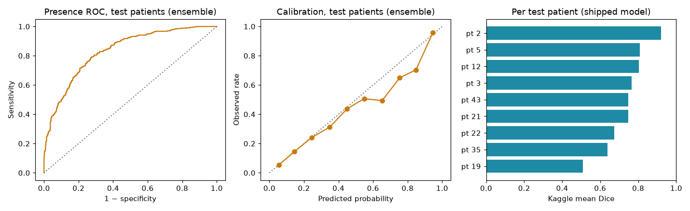

# Model card: Plexus Finder

Generated by `nerveseg/report.py` from `results/metrics.json`. Do not edit numbers by hand.

## Intended use

Research and teaching only. Highlights the brachial plexus on a single interscalene ultrasound frame.
Not a medical device. Must not guide a needle or any clinical decision.

## Data

- Source: Kaggle Ultrasound Nerve Segmentation (2016) training set, 5,635 frames from 47 patients, one annotator per frame.
- Locked test set: 9 patients (1079 frames), chosen at random with a fixed seed before any training. Positive rate 31.3%.
- Development set: the other 38 patients, in 5 patient-grouped folds.
- Label noise: 123 test frames sit in a near-identical pair with the opposite label. Across the full dataset about a quarter of near-duplicate pairs disagree (`analysis/data_profile.json`).

## Method

- U-Net, MobileNetV2 encoder pretrained on ImageNet, 4.1M parameters, plus a nerve-present classification head.
- Input 224×288 greyscale. Loss: pixel BCE + Dice on labelled-positive frames + 0.5 × presence BCE.
- Augmentation: horizontal flip, ±10° rotation, ±10% scale, ±8% shift, gamma and gain.
- Training drops unlabelled frames that are near-duplicates of a labelled frame from the same patient.
- AdamW with a one-cycle schedule, 15 epochs, best checkpoint by validation loss. A first 40-epoch run on fold 0 overfitted after epoch 12 (validation loss 0.60 rising to 1.29), so all folds were retrained at 15 epochs. That choice used fold-0 validation patients only, never the test patients.
- Decision rule tuned on out-of-fold predictions only: present if probability ≥ 0.6 and the largest region ≥ 4000 px at 420×580.

## Results

Point estimate with 95% CI from 2,000 bootstrap resamples of patients. All metrics at 420×580 against the original masks.

| Measure | Development (out-of-fold, 38 pts) | Test: shipped single model | Test: 5-fold ensemble | Test: shipped, consistent labels only |
|---|---|---|---|---|
| Sensitivity | 0.694 (0.611–0.765) | 0.533 (0.395–0.649) | 0.521 (0.362–0.649) | 0.544 (0.411–0.657) |
| Specificity | 0.846 (0.799–0.886) | 0.877 (0.820–0.931) | 0.885 (0.830–0.939) | 0.907 (0.843–0.960) |
| PPV | 0.777 (0.716–0.827) | 0.664 (0.505–0.777) | 0.674 (0.529–0.790) | 0.708 (0.515–0.856) |
| NPV | 0.782 (0.740–0.819) | 0.804 (0.716–0.871) | 0.802 (0.711–0.870) | 0.827 (0.735–0.898) |
| AUROC (presence) | 0.858 (0.826–0.886) | 0.816 (0.754–0.865) | 0.832 (0.772–0.875) | 0.843 (0.780–0.898) |
| Dice, labelled positives | 0.562 (0.490–0.624) | 0.422 (0.316–0.518) | 0.422 (0.296–0.525) | 0.431 (0.325–0.532) |
| Dice, correct detections | 0.811 (0.787–0.829) | 0.793 (0.752–0.836) | 0.809 (0.773–0.847) | 0.792 (0.751–0.845) |
| Kaggle mean Dice | 0.723 (0.692–0.755) | 0.735 (0.662–0.806) | 0.740 (0.663–0.810) | 0.767 (0.684–0.848) |
| Centroid error, px (median) | 9.211 (7.923–11.759) | 10.633 (6.985–16.879) | 9.040 (6.426–17.661) | 10.374 (6.170–19.036) |
| Brier score (presence) | 0.154 (0.136–0.172) | 0.160 (0.125–0.198) | 0.153 (0.121–0.186) | 0.142 (0.099–0.185) |

Baseline: always answering "no nerve" scores a Kaggle mean Dice of 0.687 on the test set.

## Limitations

- One public dataset, one scanner family, one annotator, no inter-rater agreement.
- Test patients come from the same collection as training patients, so this is internal validation only.
- Pixel spacing is unknown, so localisation errors are in pixels, not millimetres.
- Single frames. No temporal smoothing or live video.
- Kaggle leaderboard scores used a different, hidden test set and are not comparable.
- The test set was scored twice. Version 1 used scikit-image resizing for training and scored sensitivity 0.62, specificity 0.80 and Kaggle score 0.70 on test. Version 2, reported above, switched training to the browser's area-average resize so the shipped app matches validation exactly. That switch was decided before version 2 was scored, for parity reasons, not because of its test results.
